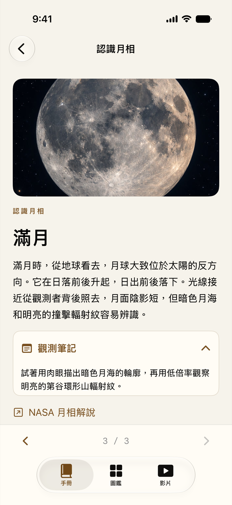
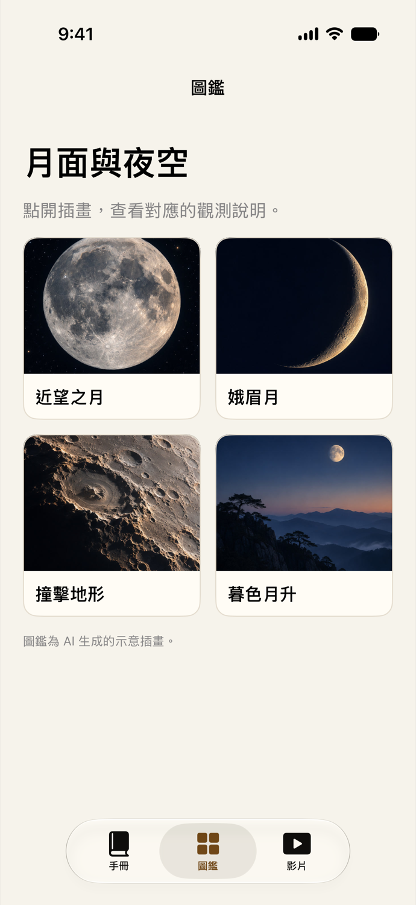
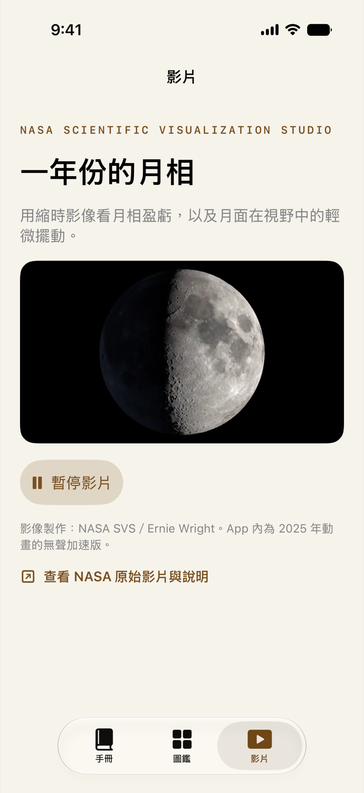
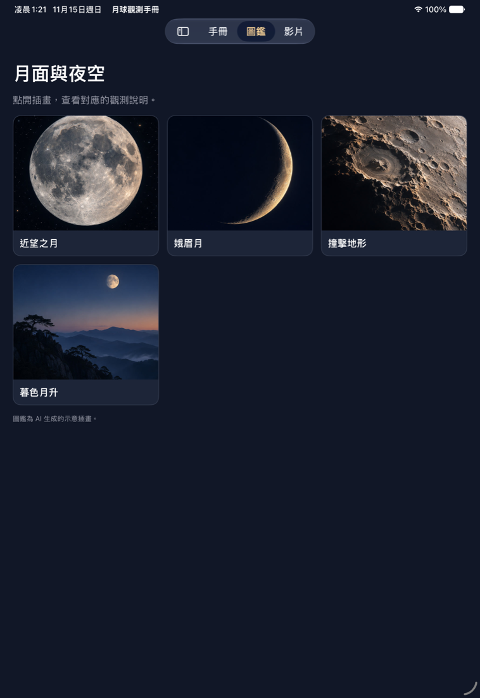
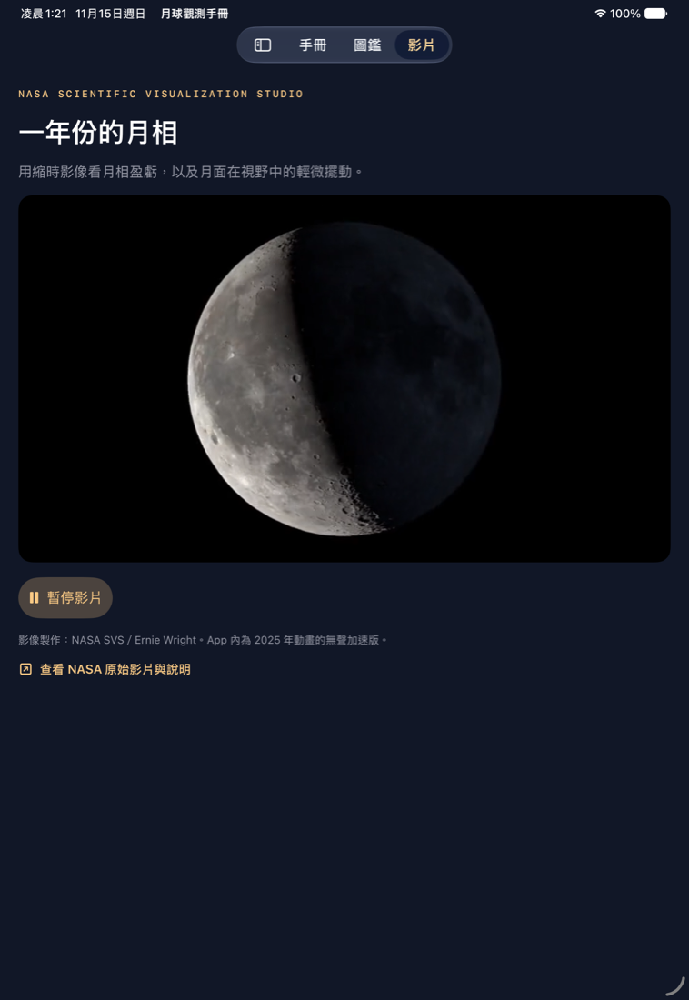

# #5 多頁面電子書｜月球觀測手冊 Lunar Atlas

把月相、月面地形和第一晚觀測，做成一本可以翻頁的 SwiftUI 電子書。


## 作業要求

這次是彼得潘的 SwiftUI 第 88 題。作品要在 iPhone 和 iPad 上展示多頁導覽、分頁、橫向滑動與動畫。我把章節、篇目和圖鑑資料寫成符合 `Identifiable` 的結構，搭配 `List`、水平 `ScrollView`、`LazyVGrid`、`Link` 和 `VideoPlayer`，並設定 App 名稱、圖示與深淺色外觀。[第 88 題作業說明](https://medium.com/彼得潘的試煉-勇者的-100-道-swift-ios-app-謎題/88-使用-swiftui-製作電子書-app-3ae9c256c960)

## 發想

如果今晚抬頭看到一彎月亮，怎麼知道它正逐漸變圓？如果手邊有一副雙筒望遠鏡，又該從月球的哪裡開始看？我用這兩個問題規劃《月球觀測手冊》，把內容分成「認識月相」、「辨識月面」和「出門觀測」三章，共七篇。每篇先說明一個概念，再附一則可以帶到戶外用的觀測筆記。

## 畫面設計

首頁以深藍夜空和近滿月做封面，內頁用暖白與深藍灰對應系統外觀。三個分頁各有不同用途。「手冊」依章節閱讀，「圖鑑」從圖片認識觀測對象，「影片」把一年內的月相變化濃縮成一段短片。

### Tab 1｜手冊

從目錄點進「認識月相」，先看到章內篇目，再選擇想閱讀的那一頁。目錄用直向 `List` 呈現，底下的「按主題瀏覽」則能水平滑動。兩處都可以進入同一個章節。

資料存在 `Chapter.all`，每章內含一個 `[Entry]`。點擊時，`NavigationLink(value:)` 把章節或篇目包成 `AtlasRoute`，再由 `navigationDestination(for:)` 建立對應的畫面。這樣就能把選中的資料一路帶進閱讀頁，導覽列也會顯示目前的章名。

```swift
ForEach(Chapter.all) { chapter in
    NavigationLink(value: AtlasRoute.chapter(chapter)) {
        chapterRow(chapter)
    }
}
```

閱讀頁用另一個 `TabView` 搭配 `.page`。從「上弦月」開啟時，選取值直接設成那篇的 ID，使用者可以接著往左滑到「滿月」，或用頁碼旁的按鈕翻頁。第一頁與最後一頁會停用超出範圍的按鈕。

```swift
TabView(selection: $selectedID) {
    ForEach(chapter.entries) { entry in
        ReadingPage(chapter: chapter, entry: entry)
            .tag(entry.id)
    }
}
.tabViewStyle(.page(indexDisplayMode: .never))
```

封面月球會緩慢縮放與漂移。點開「觀測筆記」時，箭頭旋轉，筆記內容以位移與淡入出現，收合後就能把視線留在正文。這些動畫會配合系統的「減少動態效果」設定。

### Tab 2｜圖鑑

四張示意插畫分別呈現近滿月、娥眉月、撞擊地形和暮色月升。圖鑑以 `LazyVGrid` 依可用寬度調整欄數。點選圖片後，`matchedTransitionSource` 和 `.navigationTransition(.zoom(...))` 讓畫面從原本的縮圖放大進詳情頁，內文再補充該畫面值得觀察的線索。

### Tab 3｜影片

影片頁使用 `VideoPlayer` 播放內建的月相縮時短片，可以直接播放或暫停，離線也能看。素材來自 NASA Scientific Visualization Studio，由 Ernie Wright 製作。App 裡的版本經過加速和重新編碼，長約 36.5 秒。播放頁下方的 `Link` 可打開原始資料。[NASA 月相動畫](https://svs.gsfc.nasa.gov/5415/)

## 成果展示

最外層的 `TabView` 用 `Tab` 定義「手冊」、「圖鑑」和「影片」，再套用 `.tabViewStyle(.sidebarAdaptable)`。iPhone 的分頁在底部，iPad 則從上方分頁列的按鈕切換到側邊欄。

### iPhone


*iPhone 的手冊首頁。三個功能分頁位於底部。*



*滑到「滿月」後，點開觀測筆記。底部頁碼顯示目前讀到第 3 頁。*



*點選圖鑑中的插畫，可以進入對應的觀測說明。*



*影片在 App 內播放，可以直接按下暫停。*

### iPad


*iPad 的手冊首頁。上方可切換三個分頁和側邊欄。*



*iPad 的圖鑑頁以格狀方式呈現四張示意插畫。*



*iPad 深色模式。播放中的畫面呈現月面明暗交界。*

原始碼和 Xcode 專案均在 GitHub，最低支援 iOS／iPadOS 18。[完整專案](https://github.com/alanlu01/iOS_class_5)

## 總結

這次的電子書有兩層分頁。外層處理功能切換，內層保存同一章正在讀的篇目。把篇目 ID 當作閱讀頁的選取值後，從目錄點入、滑動和按按鈕都能落在同一套頁碼邏輯。動畫也各有用途。封面用緩慢的動作帶出主題，閱讀頁讓筆記的展開方向容易看懂，圖鑑則保留縮圖與詳情的視覺連接。
